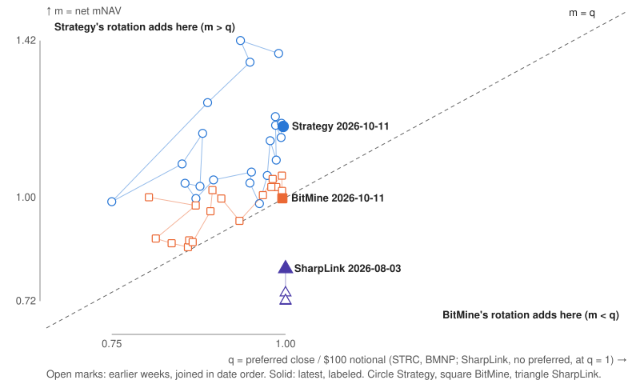

# dat-accretion: Strategy, BitMine and SharpLink capital actions measured in net coins per share

[](https://github.com/RahilBhavan/dat-accretion/actions/workflows/ci.yml)

**Live:** https://rahilbhavan.github.io/dat-accretion/



This project measures every capital action by Strategy (BTC), BitMine (ETH) and SharpLink (ETH) since 2026-06-01 on one ruler: Strategy's own net coins per share definition, applied to all three firms. Python parsers read SEC 8-K and 10-Q filings into a ledger where each row links to its filing. A numpy engine gives each action's per-share effect at disclosed prices and the price at which that effect changes sign. The output is a static page, a one-page memo, and the CSVs behind them.

## Results

Figures are for the data in the repository at this commit: filings dated 2026-06-01 to 2026-10-13 and weeks ending through 2026-10-11.

- **98 actions** parsed from SEC filings, each with an sec.gov `filing_url`: Strategy 49, BitMine 43, SharpLink 6. By type: 37 share issuances, preferred retirements and buybacks; 34 coin purchases and sales; 27 carry rows (preferred dividends, convertible interest and inferred SharpLink staking). Source: `data/actions.csv`.
- **Break-even, week ending 2026-10-11.** At net mNAV 1.191, Strategy's STRC rotation adds net sats per share while STRC trades below $119.07; STRC closed at $99.65. At net mNAV 0.998, BitMine's BMNP rotation adds net ETH per share while BMNP trades above $99.79; BMNP closed at $99.53. Source: `docs/memo.md`.
- **Weekly counts.** STRC closed below its break-even in 22 of 22 filed weeks, and BMNP closed below its break-even in 18 of 18. SharpLink's m was below 1 on 4 of 4 filed dates. Source: `docs/memo.md`.
- **SharpLink coverage.** SharpLink is measured only on the four dates its filings state ETH holdings (2026-06-16, 2026-06-28, 2026-06-30, 2026-08-03). Nothing is carried forward between them.
- **Checks.** 170 pytest cases pass offline. On 2026-10-21 the live done check, `check.py`, passed 19 of 19 checks. One of them fetched the 46 unique filing URLs in `data/actions.csv`, and all 46 returned HTTP 200.

## How it works

1. `dat/snapshot_kpi.py` saves Strategy's KPI API values each day, because the API keeps no history.
2. `dat/parse_mstr.py`, `dat/parse_bmnr.py` and `dat/parse_sbet.py` read 8-K tables by row label (an unknown label raises) and write `data/actions.csv` and `data/stated.csv`. `dat/edgar.py` fetches filings and caches them in `data/raw/`.
3. `dat/prices.py` writes Yahoo and CoinGecko daily closes to `data/prices.csv`. `dat/balances.py` rolls 10-Q anchors forward into `data/balances.csv` and `data/weekly.csv`.
4. `dat/engine.py` splits each week's change in net coins per share into price, in-the-money flips, each action, carry and a residual (`data/attribution.csv`). The break-even price is the liquidation preference × net mNAV.
5. `dat/memo.py` writes the memo and map. `dat/filings.py` writes restyled copies of the cited filings. `dat/build_site.py` writes the page data for `site/`.

`dat/refresh.py` runs steps 2 to 5 in order. `check.py` runs the live checks.

## Run it

Prerequisites: Python 3.12 or later, [uv](https://docs.astral.sh/uv/), and Node 24 only to rebuild the balance figure. The tests need no network and no credentials.

```bash
uv venv && uv pip install -e '.[dev]'
.venv/bin/python -m pytest -q
```

Observed on 2026-10-21: `170 passed`.

Rebuild the memo and the page data from the committed CSVs (offline):

```bash
.venv/bin/python -m dat.memo         # docs/memo.md, docs/memo.html, docs/map.svg
.venv/bin/python -m dat.build_site   # site/data.json
node site-src/balance/build.mjs      # site/balance.js
```

These commands need the network:

```bash
.venv/bin/python check.py            # live done check; writes data/check.json, exits 0 only if every check passes
.venv/bin/python -m dat.snapshot_kpi # appends today's Strategy KPI row to data/kpi_snapshots.csv
.venv/bin/python -m dat.refresh      # parses new filings and rebuilds the CSVs, memo and site
```

The memo PDF is printed from `docs/memo.html` with headless Chrome. `.github/workflows/refresh.yml` has the exact command.

GitHub Actions runs four workflows. `ci` runs pytest on each PR and push to `main`. `snapshot` saves the KPI row to the `data` branch each day and runs `check.py`. `pages` deploys the site only when the latest done check passed. `refresh` is scheduled for Tuesdays and squash-merges its PR only when pytest, `check.py` and CI pass. As of 2026-10-21 none of its four scheduled runs has merged a refresh. Refreshes so far were started by hand or merged as ordinary PRs.

## Repository layout

- `dat/`: one module per pipeline step, run as `python -m dat.<module>`.
- `data/`: the committed CSVs (actions, stated, balances, weekly, prices, attribution, staking).
- `docs/`: memo, methodology, decisions, build notes and a course.
- `site/`: the static page, self-hosted fonts and restyled filing copies.
- `site-src/`: Node source for the balance figure in the mechanism section.
- `tests/`: pytest suite, offline.
- `check.py`: the live done check.
- `.claude/rules/`: the method, data and framing rules the code follows.
- `.github/workflows/`: `ci`, `snapshot`, `pages` and `refresh`.
- `data` branch: daily Strategy KPI snapshots and `check.json`, appended by the `snapshot` workflow.

## Documentation

- [`docs/overview.md`](docs/overview.md): what the project does and how the pieces fit. Start here.
- [`docs/methodology.md`](docs/methodology.md): definitions, formulas and labeled estimates.
- [`docs/memo.md`](docs/memo.md): the one-page memo with the break-even table ([PDF](docs/memo.pdf)).
- [`docs/decisions.md`](docs/decisions.md): every decision, why, and the alternative it rules out.
- [`docs/how-it-was-made.md`](docs/how-it-was-made.md): the build, step by step.
- [`docs/build-notes.md`](docs/build-notes.md): problems hit while building and what they did to the numbers.
- [`docs/reader-test.md`](docs/reader-test.md): earlier reader results and the human-test protocol.
- [`docs/course/`](docs/course/README.md): a 24-lesson course that teaches the project from scratch, with quizzes.
- [`docs/README.md`](docs/README.md): index of every file in `docs/`.

## Sources

- SEC EDGAR: Strategy 8-Ks and Q2 10-Q (CIK 1050446), BitMine 8-K releases and 10-Q (CIK 1829311), SharpLink 8-Ks and Q2 10-Q (CIK 1981535). Filings dated 2026-06-01 to 2026-10-13. Requests send an identifying User-Agent and stay under EDGAR's rate limit.
- Strategy's KPI API (`api.strategy.com/btc/bitcoinKpis`): current value only, saved daily to the `data` branch.
- Yahoo Finance daily closes for MSTR, STRC, STRK, STRF, STRD, BMNR, BMNP and SBET, 2026-05-25 to 2026-10-13. CoinGecko BTC and ETH daily closes.
- strategicethreserve.xyz: an independent check of BitMine's and SharpLink's ETH holdings.

Every number traces to a filing through `filing_url`. The CSVs in `data/` are committed. Raw filings are cached in `data/raw/` (gitignored) and can be fetched again from EDGAR.

## Scope and limits

- Independent research. Not affiliated with Strategy, BitMine or SharpLink.
- The project states per-share effects and break-even prices. It makes no judgment on any decision and gives no forecast or investment view.
- Figures change when a new refresh merges. PR #41 (weekly refresh, 2026-10-20) is open and not merged.
- Some values are labeled estimates. BitMine's share count S is estimated between filings and carries an upward bias of up to 0.55% of S by 2026-10-11. BitMine `buy_coin` dollar values are coins × the week's ETH close.
- BitMine's releases do not separate staking rewards from purchases. SharpLink's staking is inferred from its holdings changes.
- Residuals are tested only for Strategy from 2026-08-02. Before that date, and for BitMine and SharpLink, they are reported and not tested.

## License

No license file yet. Third-party filings and price data belong to their owners. `site-src/anatomy-kit/` carries its own MIT license.

Part of [Rahil Bhavan's projects](https://github.com/RahilBhavan).
