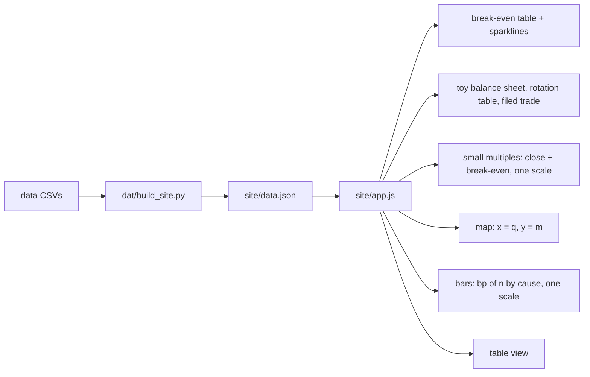

# Drawing the Map and the Bars

> A break-even table, a worked mechanism, small multiples, a map and bars, drawn by hand in SVG on shared scales, where every mark opens the filing behind it.

**Type:** Build
**Files:** `dat/build_site.py`, `site/index.html`, `site/app.js`, `site/style.css`, `dat/memo.py` (`map_svg()`), `.github/workflows/pages.yml`
**Prerequisites:** 02-01, 02-03
**Time:** ~40 minutes

## Learning Objectives

- Explain why the map uses one shared axis range for q and m, and compute that range from `data/weekly.csv`
- Describe how a mark's link is set, why every mark is one size, and where `dollars_moved` appears instead
- Compute the two shared rulers the page draws: preferred close as a percent of break-even, and a week's change in n in basis points of n
- Explain why the bars leave out the coin price and in-the-money flips, and where those values still appear
- Name the Tufte principles the charts follow and the code that applies each
- List the access features the page ships with: links as marks, one tab stop per chart, a table view, a palette checked in both themes
- Run the tests that check the page data against the CSVs

## The Problem

The engine's output is a CSV of 198 rows. A reader needs two answers from it at a glance: where each firm-week sits relative to the break-even line, and what each week's change in n was made of. Three chart failures would mislead. A map whose axes use different ranges bends the m = q line away from 45°, so a mark that sits on the line looks off it. A bar chart that stacks the coin price move buries the actions, because the price part is often 10 to 50 times the week's actions (PR #7). And three panels each on its own scale make firms of different size look alike: Strategy's net coin value ($57.5B, week ending 2026-10-04) is about 34 times SharpLink's ($1.7B, 2026-08-03), so a bar of the same height could mean a 1 bp change in one panel and a 100 bp change in the next.

The page also has to hold up at 375px wide, work from the keyboard, and load nothing from another site.

## The Concept



**The first screen.** Under the h1 and the dek sits a break-even table, one row per firm: preferred close, break-even ($100 × m), the close as a percent of break-even, and the condition ("while STRC is below"). Nine numbers read better as a table than as a graphic. Each row ends in a sparkline drawn on one shared scale, close ÷ break-even since June, with a dotted 100% line. SharpLink has no preferred, so its row shows 1 ÷ m.

**The mechanism.** "Why retiring a cheap claim adds coins per share" draws a toy balance sheet before and after, assets and claims on one scale: coins 1,000 plus cash 90 against preferred 300 and common 790. Paying $90 to retire a $100 claim leaves common at 800. A table then runs the rotation at m = 1.2: raise $120 selling common, spend it retiring STRC at $90 to $130. The total to common reaches zero at $120, which is $100 × m. Last comes the filed 7/26 trade, with its share of Strategy's net coin value that week.

**By week.** Three small multiples, one per firm, on one scale: the preferred close divided by break-even, in percent, so 100% is break-even for every firm. Strategy's rotation adds below the dashed 100% line, BitMine's above it, SharpLink's buyback above it (1 ÷ m, so m below 1). Dollar closes are in each point's details.

**The map.** x is q (the preferred's close over its $100 notional), y is m (net mNAV). Both axes share one range, so the diagonal is exactly m = q. Strategy's rotation adds above it (m > q), BitMine's below it (m < q). SharpLink has no preferred, so its marks sit at q = 1, where the line means m = 1. Every mark is one size; dollars moved are in the tooltip. Earlier weeks are open marks joined in date order; each firm's latest week is solid and labeled on the plot. This is the one chart that uses firm colors (`--f1`, `--f2`, `--f3`, with circle, square and triangle shapes), because only here do the firms share an axis. Each mark is an `<a>` that opens the week's filing.

```widget
map
```


**The bars.** One chart per firm, all three on one y scale in basis points of that week's n: value to common ÷ (n × S × p) × 10,000, which is Δn ÷ n × 10,000. Each bar stacks seven categories: issue common, buy back common, issue preferred, retire preferred, coin trades, carry, residual. Common is ink (`--ink2`), preferred is the one accent (`--accent`), coin trades and carry are grays (`--gray1`, `--gray2`), the residual is hatched gray and BitMine's estimated issuance is hatched ink inside issue common. A tick marks each week's net. There are no grid lines, only tick labels and a zero rule. The price and flip parts go in the tooltip, the totals strip and the table, not the stack. Dollars (value to common = Δn × S × p) stay in the tooltip, the strips and the table, which also gives "observed (bp of net value)".

**The principles.** The redesign follows Tufte, *The Visual Display of Quantitative Information*:

| principle | where it shows | code |
|---|---|---|
| A comparison in one sentence | each caption names what is compared: the close against break-even, each cause against zero | `index.html` `.explain` paragraphs |
| Shared scales, small multiples | the sparklines and the by-week panels share one percent ruler; the three bar charts share one bp domain | `ratioPts()`, `ruler()`, `barDomain()`, `toBp` |
| Data-ink | no cards, shadows, boxes or grid lines; ink for data, gray for context, one accent | `style.css`, `drawBars()` |
| Range frame | an axis line spans only the data, labeled at its ends (and at 100% or 1.00) | `drawPref()`, `drawMap()`, `map_svg()` |
| Direct labels | the latest point carries its value, the map labels each firm's latest week, the bars label their largest segment | `drawPref()`, `drawMap()`, `drawBars()` |
| Lie Factor near 1 | bars start at a zero rule, so a bar's length is its value; marks keep one size, since area misreads dollars; the toy balance sheet draws the mechanism because the filed trade (0.011% of net coin value) would not show at true scale | `segPath()`, `drawMap()`, `sheet()` |

## Build It

### Step 1: Group attribution rows into bar categories

`dat/build_site.py` maps each attribution action to a bar and keeps two out of the stack:

```python
CATEGORIES = ['issue_common', 'buyback_common', 'issue_pref', 'retire_pref', 'coins', 'carry', 'residual']
GROUP = {'est_issuance': 'issue_common', 'buy_coin': 'coins', 'sell_coin': 'coins'}  # attribution action -> bar
SEPARATE = ('price', 'itm_flip')  # not stacked: tooltip and table only
```

Each value is `dn_exact × S × p` at the week's S and p. `test_bars_sum_to_observed` checks that the seven categories plus price plus flips equal the observed change within $1 for every week.

### Step 2: One domain for both axes

`site/app.js`, `drawMap()`:

```javascript
  const vals = pts.flatMap(w => [w.m, w.qx]);
  // One domain for both axes so m = q is a true diagonal: [min − 0.05, max + 0.05] rounded out to 0.05.
  const lo = Math.floor((Math.min(...vals) - 0.05) * 20) / 20, hi = Math.ceil((Math.max(...vals) + 0.05) * 20) / 20;
  const X = v => M.l + (v - lo) / (hi - lo) * (W - M.l - M.r), Y = v => H - M.b - (v - lo) / (hi - lo) * (H - M.t - M.b);
  // One mark size: position carries m and q; dollars moved are in the tooltip (area is read least accurately,
  // Cleveland & McGill 1984). Each firm's weeks are joined in date order; its latest mark is solid.
  const R = W < 500 ? 4 : 5, rad = () => R;
```

The axes are range frames: each axis line spans only the data, labeled at its ends and at 1.00. There is no grid.

```javascript
  const qs = pts.map(w => w.qx), ms = pts.map(w => w.m), qlo = Math.min(...qs), qhi = Math.max(...qs), mlo = Math.min(...ms), mhi = Math.max(...ms);
  s += '<line class="axis" x1="' + X(qlo) + '" x2="' + X(qhi) + '" y1="' + (H - M.b + 6) + '" y2="' + (H - M.b + 6) + '"/>';
  s += '<line class="axis" x1="' + (M.l - 6) + '" x2="' + (M.l - 6) + '" y1="' + Y(mhi) + '" y2="' + Y(mlo) + '"/>';
  for (const v of [qlo, qhi]) s += '<text x="' + X(v) + '" y="' + (H - M.b + 20) + '" text-anchor="middle">' + v.toFixed(2) + '</text>';
  for (const v of [mlo, 1, mhi]) s += '<text x="' + (M.l - 10) + '" y="' + (Y(v) + 4) + '" text-anchor="end">' + v.toFixed(2) + '</text>';
```

The same rule in Python, on the committed data:

```
.venv/bin/python -c "
import csv, math
rows = [r for r in csv.DictReader(open('data/weekly.csv')) if r['m'] and (r['q'] or r['firm']=='SBET')]
vals = [v for r in rows for v in (float(r['m']), float(r['q']) if r['q'] else 1.0)]
lo, hi = math.floor((min(vals)-0.05)*20)/20, math.ceil((max(vals)+0.05)*20)/20
print(f'min {min(vals):.4f} max {max(vals):.4f} domain {lo:.2f} to {hi:.2f}')
"
```

```
min 0.7222 max 1.4212 domain 0.65 to 1.50
```

m reaches 1.42, so the shared range runs to 1.50. q stays near 1, so the right side of the plot stays empty. That is the cost of a true diagonal, accepted in decision M7. Every mark has the same radius: a reader compares positions more accurately than areas, so dollars moved go in the tooltip rather than into mark size.

### Step 3: Every mark is a link

```javascript
    s += '<a href="' + esc(w.filing_urls[0]) + '" target="_blank" rel="noopener" data-tip="' + i + '" aria-label="' + esc(label) + '">'
```

`filing_urls[0]` is the week's primary filing from `data/stated.csv`. The `aria-label` reads the firm, week, m and q, and ends "Opens filing." A mark is a native link, so Tab reaches it and Enter opens it.

### Step 4: One ruler for the by-week panels

`ratioPts()` turns each firm-week into the preferred close as a percent of break-even, r = q ÷ m × 100 (SharpLink: 100 ÷ m). `ruler()` takes one y domain and one date domain across all three firms, so the sparklines and the small multiples share them:

```javascript
function ratioPts(firm) {
  const sbet = firm === 'SBET';
  return DATA.weeks.filter(w => w.firm === firm && w.m != null && (sbet || w.q != null))
    .map(w => ({ w, t: Date.parse(w.week_end), r: (sbet ? 1 : w.q) / w.m * 100, close: sbet ? w.m : w.q * 100, be: sbet ? 1 : w.m * 100 }));
}
let RULER = null;  // one y domain and one x domain for the sparklines and the small multiples
function ruler() {
  const all = Object.keys(FIRM).flatMap(ratioPts), rs = all.map(p => p.r).concat(100);
  const lo = Math.floor(Math.min(...rs) / 10) * 10, hi = Math.ceil(Math.max(...rs) / 10) * 10;
  RULER = { lo, hi, t0: Math.min(...all.map(p => p.t)), t1: Math.max(...all.map(p => p.t)) };
}
```

The same rule in Python:

```
.venv/bin/python -c "
import csv, math
rs = []
for r in csv.DictReader(open('data/weekly.csv')):
    if not r['m']: continue
    if r['firm'] == 'SBET': rs.append(100 / float(r['m']))
    elif r['q']: rs.append(float(r['q']) / float(r['m']) * 100)
lo, hi = math.floor(min(rs + [100]) / 10) * 10, math.ceil(max(rs + [100]) / 10) * 10
print(f'{len(rs)} points  min {min(rs):.1f}%  max {max(rs):.1f}%  ruler {lo}% to {hi}%')
"
```

```
42 points  min 65.7%  max 138.5%  ruler 60% to 140%
```

`drawPref()` draws each panel on that ruler with a range-frame y axis labeled only at 60%, 100% and 140%, a dashed 100% reference, a label on the side where the program adds ("Rotation adds below 100%"), and an accent dot with its value on the last point. Dollars (close, break-even, gap) move into the tooltip.

### Step 5: Basis points for the bars

A dollar scale can't hold all three firms: Strategy's net coin value is about 34 times SharpLink's, so SharpLink's bars would not show. The bars divide each week's dollars by that week's net coin value, n × S × p, which gives Δn ÷ n:

```javascript
const toBp = w => 1e4 / (w.n * w.S * w.p);
...
function barDomain() {
  let lo = 0, hi = 0;
  for (const w of DATA.weeks.filter(w => w.value)) {
    const st = stack(w), k = toBp(w);
    hi = Math.max(hi, st.reduce((a, d) => a + Math.max(d[3], 0), 0) * k);
    lo = Math.min(lo, st.reduce((a, d) => a + Math.min(d[3], 0), 0) * k);
  }
  const ticks = nice(lo, hi, 4);
  BARS = { lo: Math.min(lo, ticks[0]), hi: Math.max(hi, ticks[ticks.length - 1]), ticks };
}
```

`barDomain()` runs once over every firm's weeks, and `drawBars()` reads `BARS` for all three charts. Check one segment from the CSVs: the 7/26 STRC retirement, $3.893M to common, in bp of n:

```
.venv/bin/python -c "
import csv
w = '2026-07-26'
wk = next(r for r in csv.DictReader(open('data/weekly.csv')) if r['firm'] == 'MSTR' and r['week_end'] == w)
r = next(r for r in csv.DictReader(open('data/attribution.csv')) if r['firm'] == 'MSTR' and r['week_end'] == w and r['action'] == 'retire_pref')
print(f\"retire_pref STRC  dn_exact / n x 10,000 = {float(r['dn_exact']) / float(wk['n']) * 1e4:.2f} bp\")
"
```

```
retire_pref STRC  dn_exact / n x 10,000 = 1.09 bp
```

$3.893M against $35.7B of net coin value is 0.011%, or 1.09 bp. That is why the mechanism section uses a toy balance sheet: at true scale the filed trade would be a line under a pixel tall.

### Step 6: One tab stop per chart

Each by-week panel and each bar chart holds a single `tabindex="0"`. The arrow keys move it:

```javascript
  el.onkeydown = ev => {
    const cols = [...el.querySelectorAll('.col')], i = cols.indexOf(ev.target);
    const step = { ArrowLeft: -1, ArrowRight: 1, Home: -Infinity, End: Infinity }[ev.key];
    if (i < 0 || step == null) return;
    ev.preventDefault();
    const j = Math.max(0, Math.min(cols.length - 1, i + step));
    cols[i].setAttribute('tabindex', '-1');
    cols[j].setAttribute('tabindex', '0');
    ACTIVE[el.id] = j;
    cols[j].focus();
  };
```

The tooltip follows focus, and Escape closes it. A `<details>` table under the bars lists every figure, for readers who can't use the charts.

### Step 7: Colors and sources

`site/style.css` defines three firm colors (`--f1` to `--f3`), used only on the map, plus ink, one accent and grays for everything else, with a second set for dark mode:

```css
  --accent: #1f6fd1; --ink2: #3b4250; --gray1: #9aa3ae; --gray2: #cdd3da; --neutral: #7d8693; --wash: #eff1f3;
  --f1: #2a78d6; --f2: #eb6834; --f3: #4a3aa7;
```

The firm palette was checked in both modes before use; visible labels, the mark shapes and the table view back up any pair that is hard to tell apart. `dat/memo.py` uses the same three light-mode firm colors in `COLOR`. `site/index.html` loads one stylesheet, two self-hosted fonts and two scripts (the balance figure, then the page), all local:

```
grep -nE "<script|<link" site/index.html | grep -v 'rel="icon"'
```

```
9:<link rel="preload" href="fonts/source-serif-4.woff2" as="font" type="font/woff2" crossorigin>
10:<link rel="preload" href="fonts/ibm-plex-mono-400.woff2" as="font" type="font/woff2" crossorigin>
11:<link rel="stylesheet" href="style.css">
209:<script src="balance.js"></script>
210:<script src="app.js"></script>
```

## Use It

- `.github/workflows/pages.yml` runs `python -m dat.build_site` on each push to `main` and deploys `site/` with the CSVs under `data/`, but only when the latest `check.json` on the `data` branch has status `pass` (PR #17).
- The page opens with an h1 that says what is measured, then the dek with the break-even figures, then the break-even table (`headline()`): preferred close, break-even, % of break-even, the condition, and a sparkline per row on the shared ruler. STRC adds below $100 × m, BMNP adds above $100 × m, and SharpLink's row gives m and the date of its last filed holdings. Key terms follow as a definition list. This table replaces the gauge cards of PR #28.
- `example()` replaced the four-tile "One trade, step by step" stepper: the toy balance sheet (`sheet()`, labeled "Illustration, not filed figures"), the rotation table at m = 1.2, then the filed 7/26 trade with a link to its 8-K.
- The "By week" section is three small multiples on one percent-of-break-even scale (`drawPref()`), replacing three panels each on its own dollar scale.
- The attribution bars share one bp scale across the three firms (`barDomain()`, `toBp`), colored with ink, one accent and grays, with a tick for each week's net change and a totals strip per firm.
- Each bar panel's strip shows totals since the firm's anchor week, as value to common in USD: filed actions, carry, estimated issuance (BitMine only), residual, coin price, in-the-money flips and observed. Carry and estimated issuance stay out of "filed actions" because `method.md` says carry rows are not actions.
- `dat/memo.py` (`map_svg()`) draws a static light-theme copy of the same map for the memo, with the same domain rule and the same edits: no grid, range-frame axes, open marks for earlier weeks, the latest solid and labeled, and a one-line key in place of the legend.
- The table view and the Downloads section give the same numbers as the charts.

## Ship It

The acceptance check for Step 5 was "375px wide, no horizontal scroll; every dot links to its filing", measured in headless Chromium after render (PR #7):

```
{"w":375,"sw":375,"dots":33,"tabstops0":2,"arrowMoves":true}
{"w":1280,"sw":1280,"dots":33,"tabstops0":2,"arrowMoves":true}
```

`w` equal to `sw` means the scroll width equals the viewport: no horizontal scroll. That run had 33 dots, before SharpLink was added in PR #10. The same check after the PR #18 redesign:

```
375 light {"scrollWidth":375,"inner":375,"marks":37,"marksLinked":37,"overflowing":[]} errors: none
375 dark  {"scrollWidth":375,"inner":375,"marks":37,"marksLinked":37,"overflowing":[]} errors: none
```

And after the PR #20 redesign, which added the "By week" chart:

```
375 light {"scrollWidth":375,"inner":375,"marks":37,"marksLinked":37,"weeks":39,"h1Bottom":294,"firstCardTop":656,"overflowing":[]} errors: none
375 dark {"scrollWidth":375,"inner":375,"marks":37,"marksLinked":37,"weeks":39,"h1Bottom":294,"firstCardTop":656,"overflowing":[]} errors: none
```

The 37 marks are 18 Strategy weeks, 15 BitMine weeks with a BMNP price and 4 SharpLink dates. `firstCardTop` measured the first firm card of that layout; the Tufte redesign has no cards, so a rerun of this check on it would measure the break-even table instead. The offline tests on the page data:

```
.venv/bin/python -m pytest -q tests/test_build_site.py
```

```
17 passed in 0.04s
```

## Decisions

```widget
decisions M6,M7,M8,M9,M11,M12,M13,M14,M15
```

## What Went Wrong

- Build note #23: a tighter shared domain was requested without checking that m reaches 1.42. The runner kept the full range: a true 45° line matters more than filling the right third.
- Build note #21: a shell redirect left a 0-byte `check.json` that would have broken the first Pages deploy. The workflow now writes to a temp file and moves it, and `build_site.load_check()` treats an empty or invalid file as "not yet run".

## Exercises

1. Run `.venv/bin/python -m dat.build_site` (it fetches the latest BitMine release from EDGAR if `data/raw/` doesn't have it), serve `site/` with `python3 -m http.server -d site`, and open the page at 375px wide in your browser's device mode. Confirm no horizontal scroll.
2. Change `SEPARATE` handling so `price` is stacked into the bars (add it to `CATEGORIES` and the `CAT` table in `app.js`). Look at Strategy's 2026-08-23 bar, where price is +$4,328.6M and issue common is −$215.2M, and describe what you can still read.
3. Give the map separate x and y ranges (x from q only, y from m only) and redraw. Check whether any mark now sits on the other side of the drawn diagonal from where its m and q put it, and explain why the drawn line no longer means m = q.
4. Make `drawBars()` compute its own domain per firm instead of reading the shared `BARS`. Compare SharpLink's tallest bar with Strategy's before and after, and say what a reader comparing the two panels would now get wrong.
