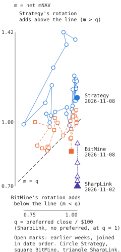

# At net mNAV 1.115, Strategy's STRC rotation adds net sats per share while STRC trades below $111.48; at 0.863, BitMine's BMNP rotation adds net ETH per share while BMNP trades above $86.33 (week ending 2026-11-08)

| Firm | Week ending | Net mNAV m | Preferred close | Break-even ($100 × m) | Rotation adds while |
|---|---|---|---|---|---|
| Strategy | 2026-11-08 | 1.115 | STRC $99.84 | $111.48 | STRC below break-even |
| BitMine | 2026-11-08 | 0.863 | BMNP $97.10 | $86.33 | BMNP above break-even* |
| SharpLink | 2026-11-02 (last filed) | 0.699 | no preferred | m = 1 | issue if m > 1; buy back if m < 1 |

STRC closed at $99.84 on 2026-11-06 (q = 0.9984). BMNP closed at $97.10 on 2026-11-06 (q = 0.9710). SBET closed at $6.49 on 2026-11-02. SharpLink's filings state ETH holdings only on 2026-06-16, 2026-06-28, 2026-06-30, 2026-08-03, 2026-09-30, 2026-11-02. *BitMine's 2026-11-08 gap between m and q is within the S-estimate bias; see the note under the map.

Key. m, net mNAV: share price over net coin value per share. q: preferred close over its $100 notional. Net sats: net bitcoin per share in satoshis (100 million per BTC). Rotation: Strategy sells common and retires STRC; BitMine sells BMNP and buys back common. STRC: Strategy's perpetual preferred, $100 stated amount. BMNP: BitMine's 9.50% cumulative preferred, $100 liquidation preference.

Digital asset treasury (DAT) companies hold bitcoin or ether and raise money by selling stock. This memo measures each share sale, buyback and preferred trade since 2026-06-01 with Strategy's own net coins per share definition, applied to all three firms (glossary, Strategy's 2026-08-24 free writing prospectus, FWP). Net coins N are coins held (C) plus USD assets (R), less out-of-the-money convertible debt and preferred notional, converted to coins at the coin price; n is N per fully diluted share, and S is that share count.

Issuing common adds to n while m is above 1; retiring preferred adds while q is below 1. So Strategy's rotation adds while m > q and stops adding when STRC trades above $100 × m; BitMine's adds while m < q and stops adding when BMNP trades below $100 × m. SharpLink has no preferred, so no rotation line applies.

STRC closed below its break-even in 26 of 26 filed weeks, and BMNP closed below its break-even in 18 of 22. SharpLink's m was below 1 on 6 of 6 filed dates.

| Since first week | Strategy | BitMine | SharpLink |
|---|---|---|---|
| Coin price | +$1,206.4M | +$179.0M | −$28.5M |
| In-the-money flips | −$338.4M | −$1.1M | −$45.3M |
| Filed actions | +$485.6M | −$49.4M | +$10.9M |
| Estimated issuance | n/a | −$19.5M | n/a |
| Carry | −$465.3M | −$13.6M | +$21.1M |
| Residual | −$256.1M | −$7.4M | −$27.5M |
| Observed | +$632.2M | +$87.9M | −$69.2M |

Value to common (change in n × S × coin price) by cause, summed from each firm's first week (Strategy and BitMine 2026-05-31, SharpLink 2026-06-16); the parts sum to the observed change before rounding. Strategy's residual is −$257.4M before 2026-08-02, when the 8-Ks did not itemize cash flows, and +$1.4M in the weeks since, which the R check tests against the filings. BitMine's and SharpLink's residuals are report only.

---

Closest weeks to the line: Strategy 2026-08-23, m 2.38% above q; BitMine 2026-10-11, m 0.14% above q. BitMine's estimated diluted share count S carries an upward bias of up to 0.00% of S by 2026-11-08 because its releases count staked ETH as purchased, which this memo costs as cash; the bias raises m by the same proportion, and removing it puts m at or below q in 5 of 22 BitMine weeks (2026-10-11, 2026-10-18, 2026-10-25, 2026-11-01, 2026-11-08), where BitMine's rotation would add.

Period: Strategy weeks ending 2026-05-31 to 2026-11-08 (26 filed dates, including the 2026-06-30 quarter-end holdings row); BitMine weeks ending 2026-06-14 to 2026-11-08 (22 weeks with a BMNP price; BMNP was issued 2026-06-10); SharpLink filed holdings dates 2026-06-16 to 2026-11-02 (6 dates; SharpLink states holdings only on those dates, and this memo carries nothing forward between them).

Sources: Strategy weekly 8-Ks, Q2 and Q3 10-Qs (EDGAR CIK 1050446); BitMine weekly 8-K releases, the 5/31 10-Q and the 8/31 10-K (EDGAR CIK 1829311); SharpLink 8-K releases and Q2 10-Q (EDGAR CIK 1981535); Yahoo Finance daily closes for MSTR, STRC, STRK, STRF, STRD, BMNR, BMNP and SBET; CoinGecko BTC and ETH closes. Each week uses closes from the last US trading day on or before the week's end.

Labeled estimates: this memo estimates BitMine's diluted share count S between filings. It anchors S to the 10-Q share counts for 2026-05-31 and 2026-07-09 and estimates unreported issuance as the week's unexplained change in cash divided by the BMNR close. BitMine's USD assets R are its stated cash and marketable securities, so R includes securities. The USD of each BitMine ETH purchase is units × that week's ETH close. SharpLink's coins held C include the liquid staking tokens (LSTs) LsETH and weETH at their stated as-if-redeemed ETH equivalence; its ETH change beyond stated purchases is inferred staking and LST accrual; its R is 2026-06-30 balance-sheet cash rolled by filed cash flows.

Page: https://rahilbhavan.github.io/dat-accretion/. Method: https://github.com/RahilBhavan/dat-accretion/blob/main/docs/methodology.md. Code and data: https://github.com/RahilBhavan/dat-accretion. Definition source: https://www.sec.gov/Archives/edgar/data/1050446/000119312526363557/d431748dfwp.htm.
